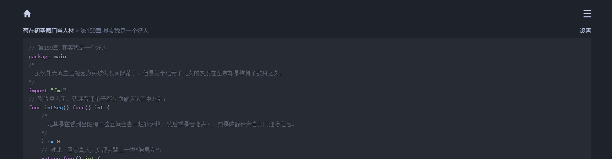
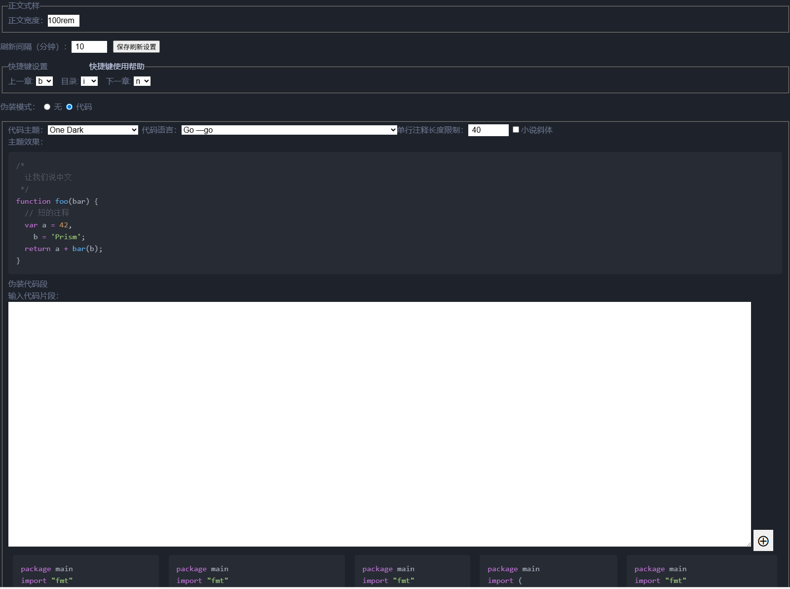

# Deqi Prefetch

[](LICENSE)


一个用于多个中文小说网站的用户脚本，支持**免翻页**连续阅读，并可将小说章节**伪装成代码**形式展示，提供清爽的阅读页面。

## 支持的网站

- 得奇小说网（`deqixs.com` / `deqixs.org`）
- 速读引擎站群：`sudugu.org`、`sudugu.cc`、`suduguu.com`、`shudugu.org`
- 酷读书（`kudushu.org`）
- 波萝猫小说（`boluomao1.com` / `yxshufang.com`）
- Biqu33（`biqu33.cc` / `beqg.cc`）
- 顶点小说（`ddxiaoshuo.cc`）
- 错层小说网（`cuoceng.com`）
- 漫画/小说站（`dmxs2.com`）
- 81小说（`81ksw.com`）

## 功能特性

- **免翻页阅读**：自动抓取并拼接下一章节内容，实现连续阅读体验，无需手动翻页
- **小说伪装成代码**：将小说内容伪装成各种编程语言的代码形式展示，支持多种编程语言与代码高亮主题
- **干净阅读页**：重构章节页面为清爽的阅读界面，屏蔽广告与干扰元素，支持移动端适配
- **自定义阅读样式**：通过页面浮动按钮（FAB）随时调整字体、字号、行间距、段间距、阅读宽度等，实时生效
- **夜间模式**：跟随系统 / 强制夜间 / 强制日间三种模式切换
- **快捷键支持**：支持使用快捷键快速跳转到上一章、下一章或目录页
- **自定义配置**：提供设置页面，可自定义代码语言、主题、注释长度、行号、伪代码片段等参数
- **书架自动刷新**：在书籍主页可设置定时刷新，自动获取最新章节信息

## 预览截图

章节内容伪装成代码效果：


设置页面：


## 安装方式

1. 首先安装浏览器用户脚本管理器，如 [Tampermonkey](https://www.tampermonkey.net/) 或 [Violentmonkey](https://violentmonkey.github.io/)
2. 访问 [Greasy Fork](https://greasyfork.org/zh-CN/scripts/537588-deqi-prefech) 安装脚本
3. 访问任意一个[支持的网站](#支持的网站)开始使用

> 项目还提供 **Lite 精简版**：不加载 Prism.js，不包含代码伪装与代码高亮功能，仅提供免翻页与干净阅读页，适合追求轻量化的用户。

## 使用说明

安装脚本后，访问支持的阅读网站时，章节内容会以干净的阅读页面展示。

### 页面浮动按钮（FAB）

阅读页面右下角有一个「+」浮动按钮，展开后提供：

- **⬆ 滚动到顶部** / **⬇ 滚动到底部**
- **⚙ 页面设置**：打开设置对话框，可实时调整宽度、字号、字体（含快速预设）、行间距、段间距、夜间模式等

### 支持的代码语言

伪装成代码时可选择以下编程语言（默认 JavaScript）：

- JavaScript（默认）
- Markup / HTML(CSS)
- CSS
- C / C-like
- C# / C++
- Java / Kotlin
- Go
- PHP
- Python
- Rust

### 快捷键

快捷键功能利用 [accesskey](https://developer.mozilla.org/zh-CN/docs/Web/HTML/Reference/Global_attributes/accesskey#%E5%B0%9D%E8%AF%95%E4%B8%80%E4%B8%8B) 属性实现。由于不同操作系统和浏览器的差异，快捷键激活方式可能不同：

#### Windows/Linux 系统：

##### Chrome/Edge

- `Alt+H`：返回目录页
- `Alt+N`：跳转下一章
- `Alt+B`：跳转上一章

##### Firefox

- `Alt+Shift+H`：返回目录页
- `Alt+Shift+N`：跳转下一章
- `Alt+Shift+B`：跳转上一章

#### macOS 系统：

- `Control+Option+H`：返回目录页
- `Control+Option+N`：跳转下一章
- `Control+Option+B`：跳转上一章

> 注意：某些浏览器可能使用不同的组合键，如果上述快捷键无效，请尝试将 `Alt` 替换为 `Ctrl` 或 `Meta` 键。你也可以在脚本设置页面自定义快捷键（上一章 / 目录 / 下一章）。

## 开发

### 技术栈

- TypeScript
- [Vite](https://vitejs.dev/) + vitepress-plus / vite-plus
- [Prism.js](https://prismjs.com/)（代码高亮）
- [vite-plugin-monkey](https://github.com/lisonge/vite-plugin-monkey)（用户脚本构建）
- pnpm

### 本地开发

```bash
# 克隆项目
git clone <项目地址>

# 安装依赖
pnpm install

# 开发模式
pnpm dev

# 构建脚本
pnpm build

# 构建 Lite 精简版
pnpm build-all   # 或使用 just: just build-lite

# 预览构建结果
pnpm preview
```

> 完整版与 Lite 版脚本均输出到 `dist/`，可分别通过 `just build` / `just build-lite`（或 `just build-all`）构建。

### 项目结构

```
src/
├── main.ts             # 入口文件，路由分发与初始化
├── base.ts             # 抽象重构器基类（AbstractRebuilder）
├── deqixs.ts           # 得奇 / 速读引擎站处理器
├── biqu33.ts           # Biqu33 处理器
├── ddxiaoshuo.ts       # 顶点小说处理器
├── cuoceng.ts          # 错层小说网处理器
├── kudushu.ts          # 酷读书处理器
├── dmxs.ts             # dmxs2 处理器
├── 81ksw.ts            # 81小说处理器
├── boluomao.ts         # 波萝猫小说处理器
├── code.ts             # 代码伪装与高亮相关功能
├── config.ts           # 配置、设置对话框与 FAB
├── config-dialog.css   # 设置对话框样式
├── editable-list.ts    # 可编辑列表组件（伪代码片段编辑）
├── style.css           # 样式文件
├── utils.ts            # 工具函数与阅读页重构
└── vite-env.d.ts       # 类型声明
```

## 许可证

MIT
